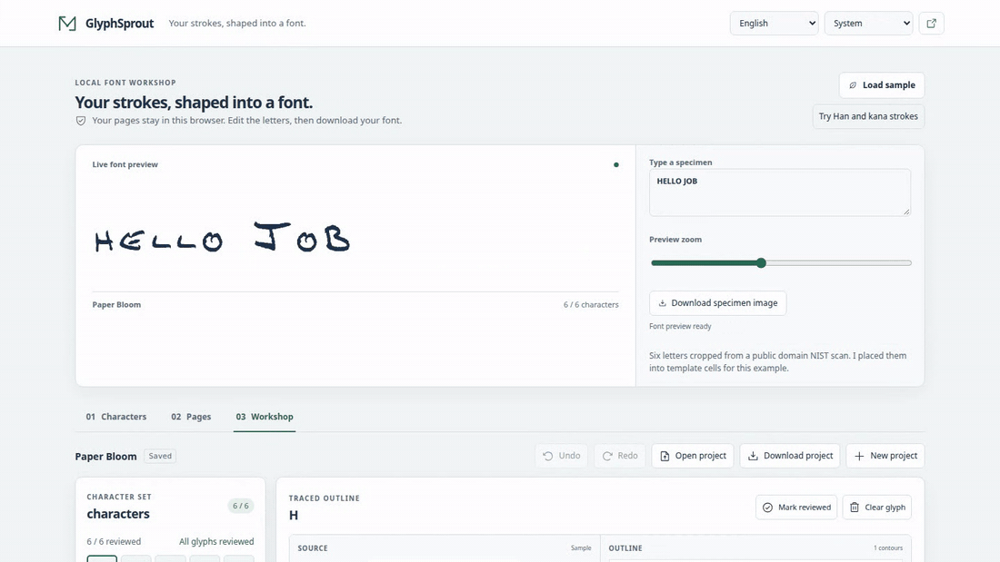

[English](README.md) | [繁體中文](README.zh-TW.md) | [简体中文](README.zh-CN.md) | [한국어](README.ko.md) | [Español](README.es.md) | [Français](README.fr.md) | [Deutsch](README.de.md) | [Português (Brasil)](README.pt-BR.md)

# GlyphSprout

プロジェクトで使う単語や名前のために、小さなフォントを作れます。テンプレートを印刷して文字を書き、スキャンした輪郭を確認し、入力に使えるフォントを書き出します。

**手書きの 6 文字。3.4 kB のフォント。**

同梱の Paper Bloom サンプルは 3,360 バイトの TTF を出力し、Fontconfig と FreeType で確認しています。この測定対象は 6 文字です。[測定方法と再現可能な書き出し手順](docs/VALIDATION.md)。

[オンライン作業場を開く](https://Arthur031221.github.io/GlyphSprout/) | [ユーザーガイド](docs/USAGE.md) | [](LICENSE)



```sh
npx --yes git+https://github.com/Arthur031221/GlyphSprout.git#v1.21.0
```

Node.js 22.12 以降と Git が必要です。起動完了のメッセージが表示されたら `http://127.0.0.1:4173` を開きます。

| はじめに用意するもの | 作成できるもの |
| --- | --- |
| 印刷した用紙に書いた自分の文字 | 元画像、輪郭、字間を編集できる小さなフォント |

## 最初のフォントを作る

1. プロジェクトを作り、`Hello!` など必要な文字を選びます。大文字、数字、句読点、アクセント付き文字、ギリシャ文字、キリル文字、ひらがな、カタカナ、ハングル字母などの文字セットは、ワンクリックでまとめて追加できます。
2. テンプレートを A4 または US レターの用紙に実際のサイズで印刷し、各マスに 1 文字を書きます。
3. 均一な明るさでスキャンした画像を、ファイル選択、スキャン欄へのドロップ、またはスマートフォンの「写真を撮る」で追加し、ページ ID を確認します。GlyphSprout は四つの位置合わせ十字を探して四隅を置きます。各隅を確認し、ずれていれば直してください。
4. **スキャンを変換**をクリックし、変換が終わるまで待ちます。
5. 各字形を確認します。元画像、しきい値、線の太さ、輪郭のなめらかさ、切り抜き、サイズ、オフセット、字間を調整します。 数値の設定にはスライダーが付いています。値を入力して Enter を押すか、スライダーを動かして離すと、輪郭が更新されます。Ctrl+Z または Cmd+Z で変更を取り消し、Shift を加えるとやり直せます。縦の破線で左端と送り幅を示すので、調整しながら各字形の字間を確認できます。
6. プレビューに文章を入力し、TTF または WOFF2 をダウンロードします。 すべてのグリフが準備できると、プレビュー欄の **フォントをダウンロード（TTF）** で、工房までスクロールせずに保存できます。 文章の中でフォントにまだない文字は赤く表示されます。**これらの文字を追加** を押すとプロジェクトに加わり、その文字のマスを印刷できます。文字を変更するとスキャンのページ割り当てが消えるので、割り当て直してください。

「元画像を編集」では現在のピクセルを読み込み、消しゴムやペンで一部を直して、その操作を元に戻せます。設定とページ ID は維持されます。変更した字形は再確認が必要です。「字形を描く」は白紙から始まり、字形を置き換えて設定を初期化します。空の描画は適用されません。変更のない編集ではプロジェクト履歴は変わりません。

拡大すると細部を修正できます。ペンと消しゴムの太さは元画像のピクセル単位なので、拡大率を変えても描く線の太さは変わりません。移動ツール、スクロールバー、矢印キーで画像を移動できます。変換を停止してもスキャン、角の位置、ページ確認は保持され、再試行できます。削除するには **準備中のスキャンを破棄** を選びます。

確認済みにする操作は、濃さや切り抜きの調整が完了するまで待ちます。スキャンした文字の点や輪郭が多すぎて書き出せない場合、元画像を保持し、該当する文字を表示します。他の文字は変換されます。ノイズ除去、切り抜き、元画像を調整してから、修正した文字を確認してください。

確認の進み具合はグリフ一覧の横に表示されます。 一覧の各タイルにはトレースした輪郭が描かれるので、小さすぎたり位置がずれたりしたグリフがひと目で分かります。**次の未確認へ** で次の未確認グリフに移動でき、矢印キーでもグリフを切り替えられます。字間パネルでは、フォント全体の単語間スペースを設定し、1 つのグリフのラテン字サイドベアリングをすべてのラテン字にコピーできます。**プレビュー画像をダウンロード** で、プレビュー文字を PNG として保存できます。**Web フォント用 CSS をコピー** は、ダウンロードしたファイルをウェブサイトで使うための `@font-face` ルールをクリップボードに入れます。**プレビューの拡大** でライブプレビューの大きさを変えられます。**フォント情報** パネルでは、デザイナー、著作権表示、ライセンスを書き出すフォントに記録でき、SIL Open Font License をワンクリックで入力できます。

「Characters」のフォント名と使用する文字は、画面を移動しても下書きとして残ります。**Project ready**を選ぶと反映されます。それまではバックアップとダウンロードに反映前の値が使われます。未反映の変更は再読み込みすると失われます。

## 小さなサブセットと明確な制限

対応する BMP 文字を最大 512 文字まで選べます。A4 テンプレート 1 枚には 35 マスがあり、プロジェクトでは最大 15 ページを使えます。ラテン文字、ギリシャ文字、キリル文字の字形は初期設定で比例間隔、漢字、かな、ハングルは固定の字送りを使います。画面は 9 言語、ライトとダークのテーマ、小さな画面向けのレイアウトに対応しています。

スキャンには印刷したテンプレート、濃いインク、平らな紙、均一な照明、四つの位置合わせマークが必要です。変換時に、各マスの柔らかい影や暗めの照明は補正されますが、強い照り返しや濃い影は撮り直しが必要です。ページの割り当てと確認は手動です。GlyphSprout は手書きを読み取らず、マスを自動認識しません。

書き出すのはヒンティングのないシンプルな輪郭です。輪郭のなめらかさは、新しくトレースした輪郭のピクセルの段差を直線の斜めの線分にならします。0にすると、ピクセル単位の正確な輪郭を保ちます。カーニングは 1 ペアずつ設定でき、最大 500 ペアまで、シンプルな `kern` テーブルとして書き出します。曲線フィッティング、連続した筆記のシェーピング、言語全体を網羅する文字セットには対応していません。漢字とかなのサンプルには、独自に作成した合成の線を使い、その旨を表示しています。

## 作業を保存する

プロジェクトデータはブラウザー内に保存されます。アプリがプロジェクトをアップロードしたり、リモート分析を行ったりすることはありません。大切な作業を閉じる前に `.glyphsprout.json` のバックアップをダウンロードしてください。IndexedDB は最新とその前の保存版を保持し、保存画像のハッシュを確認します。別のタブで新しい版が保存されている場合は警告します。

フッターに **Ready for offline use** と表示された後はオフラインで使えます。アプリ本体、ワーカー、WOFF2 エンコーダーがキャッシュされます。初回アクセスにはネット接続が必要です。ブラウザーのストレージを消去すると、復元データとキャッシュの両方が削除されることがあります。

## 作成したフォントをインストールする

デスクトップにインストールする場合は TTF を使ってください。以下は各環境での手順で、すべてのアプリがこのフォントに対応するという保証ではありません。必要に応じてアプリを再起動してください。

<details>
<summary>macOS</summary>

Finder でダウンロードした TTF をダブルクリックし、Font Book で **インストール** を選びます。[Apple の Font Book ガイド](https://support.apple.com/guide/font-book/install-and-validate-fonts-fntbk1000/mac)。

</details>

<details>
<summary>Windows</summary>

ダウンロードした TTF を右クリックして **インストール** を選びます。設定からインストール済みフォントを管理することもできます。[Microsoft のフォントガイド](https://support.microsoft.com/en-us/windows/experience/personalization/manage-fonts-in-windows)。

</details>

<details>
<summary>Fontconfig を使う Linux</summary>

TTF をユーザーのフォントディレクトリにコピーし、キャッシュを更新します。一般的な XDG データディレクトリを使うシステムでは、次のようにします。

```sh
mkdir -p ~/.local/share/fonts
cp Weekend.ttf ~/.local/share/fonts/
fc-cache -f ~/.local/share/fonts
```

異なるフォントディレクトリを設定している場合は、そのディレクトリを使ってください。[Fontconfig 設定ガイド](https://fontconfig.pages.freedesktop.org/fontconfig/fontconfig-user.html)。

</details>

<details>
<summary>Web ページ</summary>

WOFF2 をダウンロードし、`@font-face` で読み込みます。フォントに含まれるのは書き出した文字だけです。

```css
@font-face {
  font-family: "Weekend";
  src: url("Weekend.woff2") format("woff2");
}
```

</details>

## 検証と出典

Paper Bloom には、パブリックドメインの [NIST SD19 フォーム f1002_33](https://commons.wikimedia.org/wiki/File:NIST_SD-19_f1002_33.png) から切り抜いた 6 文字が含まれています。フォーム全体は含めていません。[公式データセットページ](https://www.nist.gov/srd/nist-special-database-19)、切り抜き座標、固定した出典チェックサムは[検証ガイド](docs/VALIDATION.md)に記載しています。

バージョン 1.3.0 で書き出したサンプルフォントを LibreOffice で開き、フォントを埋め込み、テキストを保持した PDF として保存しました。バージョン 1.3.1 で変わるのは内部のフォント名だけです。ブラウザーからダウンロードした両形式のファイルを FontTools で解析し、FreeType で描画しました。参照用フィクスチャでは、カウンター、離れた点、ディセンダー、3 種類のラスタサイズでの漢字ストロークを確認します。手順、除外項目、コマンドはガイドを参照してください。

## ドキュメントと開発

- [インストールとコマンドオプション](docs/INSTALLATION.md)
- [使い方](docs/USAGE.md)
- [設定と制限](docs/CONFIGURATION.md)
- [アーキテクチャ](docs/ARCHITECTURE.md)
- [検証](docs/VALIDATION.md)
- [コントリビューション](CONTRIBUTING.md)

GlyphSprout は [MIT ライセンス](LICENSE)で利用できます。同梱の依存関係とサンプルの出典は[サードパーティ通知](THIRD_PARTY_NOTICES.md)に記載しています。

Assisted by Claude/Codex.
